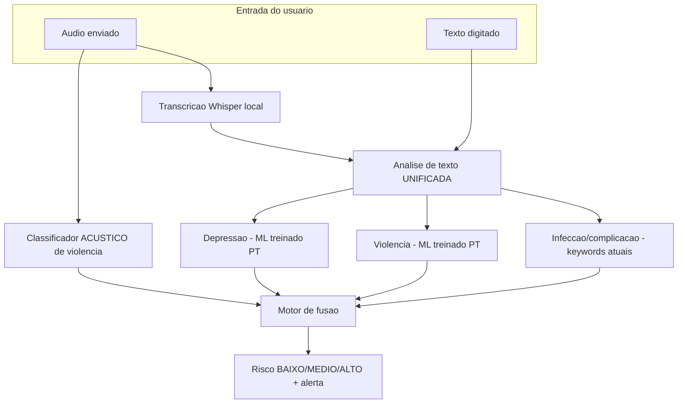

# Fase 8 — Áudio/Texto Unificado (depressão e violência)

> Objetivo: trocar a abordagem por **palavras-chave** de áudio/texto por **classificadores ML
> locais** treinados em PT-BR, adicionar uma trilha **acústica** própria para violência e
> **unificar** a análise textual. Tudo **local/offline** (sem Azure). Planejamento (Specify) em
> [`.specs/features/fase8-audio-texto-unificado/spec.md`](../.specs/features/fase8-audio-texto-unificado/spec.md).

> ⚠️ **Escopo confirmado pelo pedido "implemente a Fase 8".** As Fases 1–4 já entregam o Tech
> Challenge; a Fase 8 aprofunda os requisitos de **Análise de Áudio Especializada** (depressão
> pós-parto, vítimas de violência) e de **texto**, mantendo o contrato estável (campos novos +
> legados derivados, **sem regressão**).

## Descoberta-chave

Hoje o áudio **já é transcrito antes de classificar** (`ai-service/app/audio/classificacao.py` →
`inferir()` → `transcrever()` → `classificar()`), mas áudio e texto usavam motores **separados** e
por **palavras-chave**:

- **Áudio:** categorias `neutro/ansiedade/depressao_pos_parto/violencia/fadiga` → `{categoria,
  confianca}` — **sem** modelo acústico (tudo vinha da transcrição).
- **Texto:** achados `complicacao/sinal_infeccao/neutro` — **sem** `violencia`, e a depressão caía
  dentro de `complicacao`.

A Fase 8 adiciona uma trilha **acústica** (som) e unifica a análise textual com **ML**.

## Nova arquitetura



- **Áudio submetido →** (1) classificador **acústico** de violência (`audio → {rotulo, confianca}`)
  **e** (2) transcrição → análise de texto unificada.
- **Texto digitado →** apenas análise de texto unificada.
- **Análise de texto unificada** = depressão (ML, ShreyaR traduzido) + violência (ML, Spiderman01
  traduzido + negativos) + infecção/complicação (keywords atuais, **preservadas**).

## Schema/contrato (ver [contrato-api.md §2/§3](contrato-api.md))

Evidência de **texto**:

```json
{
  "achado": "complicacao | sinal_infeccao | neutro",
  "trecho": "frase que disparou o achado clínico (keywords)",
  "depressao": { "rotulo": "depressao | neutro", "confianca": 0.0 },
  "violencia": { "rotulo": "violencia | neutro", "confianca": 0.0 }
}
```

Evidência de **áudio** (análise dupla + campos legados derivados para compatibilidade):

```json
{
  "acustico": { "rotulo": "violencia | neutro", "confianca": 0.0 },
  "transcricao": "texto transcrito pelo ASR local",
  "texto": { "achado": "...", "trecho": "...", "depressao": {…}, "violencia": {…} },
  "categoria": "neutro | ansiedade | depressao_pos_parto | violencia | fadiga",
  "confianca": 0.0
}
```

- **Depressão x `complicacao`:** a depressão **saiu** de `TERMOS_COMPLICACAO` (que ficou só com
  complicações obstétricas) e passou ao sinal **ML** `texto.depressao` — evita dupla contagem na
  fusão.
- **Categoria legada de áudio:** **mantida por compatibilidade** e **derivada** da análise dupla
  (violência se acústico **ou** texto-violência; `depressao_pos_parto` se texto-depressão; senão
  `neutro`), para não quebrar fusão/relatório/testes existentes.

## Ferramentas locais (sem Azure)

- **Tradução EN→PT (lote, offline):** **Argos Translate** (`argostranslate`, CPU, MIT) é o
  **padrão** — baixa o pacote de idioma `en→pt` uma vez e traduz offline. **X-ALMA**
  (`haoranxu/X-ALMA-13B-Group2`, Group 2 inclui `pt`) é a opção **preferencial selecionável** por
  `TRADUCAO_BACKEND=xalma` — apenas **estruturada/documentada**; o fluxo padrão **não** baixa o
  modelo de 13B. No M4 Pro (48 GB), X-ALMA roda em fp16 via PyTorch **MPS** (`bitsandbytes` 4-bit
  **não** funciona em Apple Silicon; usar MLX/llama.cpp para quantizar).
- **Transcrição (ASR):** **Whisper local** (`openai-whisper`); `faster-whisper` como alternativa.
- **Classificação:** `scikit-learn` (TF-IDF + LogisticRegression para texto; MFCC + LogisticRegression
  para o acústico). `sentence-transformers` multilíngue fica como opção de embeddings.

## Tarefas

| # | Tarefa | Entrega |
|---|--------|---------|
| 8.1 | **Dependências** | `librosa`, `faster-whisper`, `sentence-transformers`, `argostranslate` em `ai-service/requirements.txt`; `datasets`/`huggingface-hub` em `scripts/requirements-data.txt` |
| 8.2 | **Pipeline de dados** | `scripts/data_prep/fase8_datasets.py` (download HF + tradução Argos + negativos) e `scripts/data_prep/traducao.py` (Argos padrão; X-ALMA opcional) |
| 8.3 | **Schema** | `evidencia_texto` (+`depressao`/`violencia`), `evidencia_audio_unificada` e domínios em `app/schemas.py` (validação + testes) |
| 8.4 | **Treino texto** | `app/texto/treino.py` (depressão + violência; artefatos em `models/texto/`, métricas `metrics.json`) |
| 8.5 | **Treino acústico** | `app/audio/treino.py` (MFCC + LogReg; `models/audio/violencia_acustico.joblib`) + `app/audio/features.py` |
| 8.6 | **Áudio dupla** | `app/audio/classificacao.py` reescrito (acústico + transcrição→texto unificado; fallback gracioso) |
| 8.7 | **Texto unificado** | `app/texto/nlp.py` reescrito (depressão ML + violência ML + keywords; fallback gracioso) |
| 8.8 | **Fusão + limiares** | `app/fusao.py` + `app/limiares.py` (gatilhos: violência acústica `≥0.7`, violência/depressão no texto `≥0.6`) |
| 8.9 | **Testes** | schema, classificadores (mocks/fixtures pequenas), áudio dupla e fusão ponta-a-ponta |
| 8.10 | **Docs** | esta página + spec; `datasets.md` §4/§5; `02-fase2` (2.4/2.5/2.7); `contrato-api` §2/§3; `PLANO`/`STATE` |

## Como rodar (a partir de `ai-service/`, exceto data prep)

```bash
# 1) Dados (na raiz do repo) — requer rede do HF na 1ª vez; offline depois
python -m scripts.data_prep.fase8_datasets --limite 400        # texto (dep.+viol.) + áudio
python -m scripts.data_prep.fase8_datasets --apenas audio      # só o acústico

# 2) Treino (em ai-service/)
python -m app.texto.treino          # depressão + violência → models/texto/*.joblib
python -m app.audio.treino          # violência acústica   → models/audio/*.joblib

# 3) Inferência (programática)
python -c "from app.texto.nlp import analisar; print(analisar('me sinto sem esperança'))"
```

> Sem os modelos treinados, **tudo degrada para o fallback por palavras-chave** (DD10) — o gate
> (`ruff`+`pytest`) roda sem download/treino.

## Resultados do treino (ambiente do grupo, 2026-06-27)

Treino executado com os comandos acima; pesos e `metrics.json` versionados em `ai-service/models/`.

| Modelo | Algoritmo | n (treino/teste) | F1 macro | Acurácia |
|--------|-----------|------------------|----------|----------|
| Depressão (texto) | TF-IDF + LogReg | 300 / 100 | **0,93** | 0,93 |
| Violência (texto) | TF-IDF + LogReg | 409 / 137 | **1,00** ⚠️ | 1,00 |
| Violência (acústico) | MFCC + LogReg | 300 / 100 | **0,94** | 0,94 |

> ⚠️ **Violência (texto) com F1 = 1,0** é um **alerta de cautela**, não um troféu: positivos e negativos
> vêm de **datasets de fonte distinta**, tornando as classes **separáveis demais** (vazamento de fonte) —
> o classificador aprende vocabulário de origem, não semântica de violência.
>
> **Mitigação tentada (código):** `_negativos_violencia()` passou a usar negativos do **mesmo domínio** (posts
> do ShreyaR, misturando neutros e de depressão) e o pipeline TF-IDF foi **regularizado** (`min_df`
> adaptativo, `max_features=5000`, `sublinear_tf`, L2 `C=0.5`). **Resultado do retreino (2026-06-27):** o F1
> **permaneceu 1,0** (273 positivos + 273 negativos; matriz 69/68, zero erros).
>
> **Conclusão honesta:** o teto **não é** de regularização, e sim de **dados** — positivos (`Spiderman01`,
> só **273** posts, *positivos-only*) e negativos (`ShreyaR`) vêm de **datasets/tópicos distintos**, então o
> classificador os separa por **vocabulário de fonte**, não por semântica de violência. **Não generaliza**
> para texto clínico real. Por isso, a detecção de violência **não depende** deste classificador isolado: o
> sistema usa **trilha acústica** + **keywords clínicas** + transcrição (camadas redundantes na fusão).
> **Para um F1 real seria preciso um único dataset com rótulos violência/não-violência da mesma fonte**
> (decisão de dados do grupo — datasets adotados em S29).

## Definition of Done

- [x] Deps locais nas versões estáveis atuais; sem Azure nos módulos reescritos.
- [x] Pipeline de dados idempotente (download + tradução offline + negativos), tolerante a rede.
- [x] Schema com `depressao`/`violencia` (texto) e `acustico`/`transcricao`/`texto` (áudio) + legado.
- [x] Treinos de texto (depressão/violência) e acústico funcionando com poucas amostras + métricas.
- [x] `nlp.py`/`classificacao.py` com **fallback gracioso** quando os modelos faltam.
- [x] Fusão com gatilhos de violência (acústica/texto) e depressão (texto), sem regressão.
- [x] **Gate verde** (`ruff` + `pytest`) — **129 testes** Python (+17).
- [x] Docs/contrato/datasets/STATE atualizados.

## Limitações honestas

- Licenças dos 3 datasets **não especificadas** no HF (**risco** registrado; os dados são versionados
  para reprodutibilidade — ver `data/README.md` §Origem e licença).
- Domínio Reddit/Twitter (depressão/violência) **≠** pós-parto; a tradução EN→PT adiciona ruído.
- Violência acústica pode se **perder na transcrição** → a trilha do som é separada.
- Conjunto de violência em texto é pequeno (273) → mantém-se o **fallback por keywords**.
- Treino/avaliação seguem a filosofia **mini-dataset** ("se rodar com 5, roda com 500"): métricas
  ilustrativas; escalar exige mais amostras.
