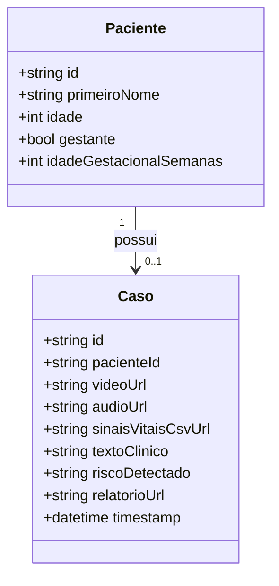

# Arquitetura de Software

> Padrão recomendado: **microserviços** com **Node.js como orquestrador** e **Python como motor de IA**, integrados à **Azure**. Essa separação isola responsabilidades e pontua em engenharia de software no relatório.

## 1. Fluxo de dados

```
1. Upload      → usuário envia vídeo/áudio/sinais para a API Node.js
2. Armazenamento → Node salva o arquivo no Azure Blob Storage
3. Disparo     → Node chama o serviço Python (HTTP/REST ou fila RabbitMQ)
4. Inferência  → Python baixa o arquivo, roda YOLO + sinais vitais + áudio
5. Resposta    → Python retorna JSON com o veredito (risco)
6. Persistência→ Node grava no banco e dispara o alerta para o dashboard
```

```
┌──────────┐   upload    ┌─────────────┐   blob    ┌──────────────────┐
│  Usuário │ ──────────► │  Node.js    │ ────────► │ Azure Blob Storage│
└──────────┘             │ (Express)   │           └──────────────────┘
                         │ Orquestrador│
                         └──────┬──────┘
                                │ HTTP POST /inferencia
                                ▼
                         ┌─────────────┐
                         │ Python      │  YOLOv8 + Sinais Vitais + Áudio + Texto
                         │ (FastAPI)   │  ──► Motor de Fusão ──► Relatório automático
                         └──────┬──────┘
                                │ JSON de risco
                                ▼
                         ┌─────────────┐   WebSocket/SSE   ┌────────────┐
                         │ Banco +     │ ────────────────► │ Dashboard  │
                         │ Node        │  alerta em        │ (tempo real)│
                         └─────────────┘  tempo real       └────────────┘
```

## 2. Por que essa abordagem

- **Independência de ambiente:** o ecossistema de visão computacional (YOLO, OpenCV, PyTorch) é muito mais maduro em Python do que em JS.
- **Escalabilidade:** dá para escalar só o serviço Python (em container/ACI) se o processamento pesar, sem afetar a API.
- **Manutenção:** trocar o modelo de IA não mexe no backend.
- **Debugging:** falha de IA fica isolada no log do Python.

## 3. Responsabilidades

| Camada | Tecnologia | Responsabilidade |
|--------|-----------|------------------|
| Orquestrador | Node.js + Express | Upload, autenticação, banco, dashboard, alerta em tempo real (WebSocket/SSE), integração Azure |
| Motor de IA | Python + FastAPI + Uvicorn | YOLOv8, sinais vitais, áudio, texto/NLP, fusão, relatório automático |
| Armazenamento | Azure Blob Storage | Vídeos, frames de alerta, relatórios |
| Hospedagem | Azure App Service / Functions / Container | Rodar os serviços |
| Orquestração local | Docker + docker-compose | Subir tudo com um comando (ver [qualidade-testes-ci.md](qualidade-testes-ci.md)) |

## 4. Exemplo conceitual

**Node.js (Express):**
```javascript
app.post('/analisar-cirurgia', async (req, res) => {
  const videoUrl = await uploadParaAzure(req.file);
  const resultadoIA = await axios.post('http://servico-python/inferencia', {
    url: videoUrl,
    dados_vitais: req.body.dados_vitais,
  });
  await db.salvarLog(resultadoIA.data);
  res.json(resultadoIA.data);
});
```

**Python (FastAPI):**
```python
@app.post("/inferencia")
async def inferencia(data: Request):
    deteccao = modelo_yolo.predict(data.url)
    anomalia = checar_sinais_vitais(data.dados_vitais)
    return {"status": "ok", "risco": avaliar_fusao(deteccao, anomalia)}
```

## 5. Decisões de empacotamento
- O **Node.js** é o repositório principal.
- O **Python** fica em `/ai-service` no mesmo repositório (ou repo separado).
- No vídeo final, mostre esse diagrama de comunicação em tempo real.

## 6. Reprodutibilidade, testes e segurança
- **Docker/docker-compose** para subir a stack — ver [qualidade-testes-ci.md](qualidade-testes-ci.md).
- **Testes automatizados + CI** (foco no motor de fusão) — ver [qualidade-testes-ci.md](qualidade-testes-ci.md).
- **Privacidade/LGPD** (TLS, Key Vault, anonimização) — ver [07-privacidade-e-seguranca.md](07-privacidade-e-seguranca.md).

## 7. Modelo de dados

Modelo enxuto: cada **entrada cria um Paciente novo**, que recebe **um Caso** (os dados enviados + o resultado da análise). Dados do paciente são mínimos e pseudonimizados.



- `gestante = false` → `idadeGestacionalSemanas` não se aplica.
- **Excluir** o paciente remove em cascata o seu `Caso` e os artefatos no Blob.
- Endpoints de gestão (Front-end ↔ Node): `POST /pacientes`, `GET /pacientes`, `DELETE /pacientes/{id}`. A análise (`POST /analisar`) referencia o `pacienteId`.
