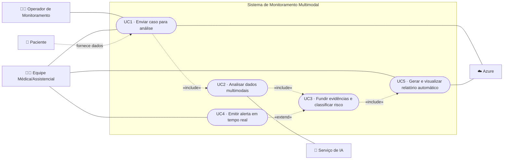
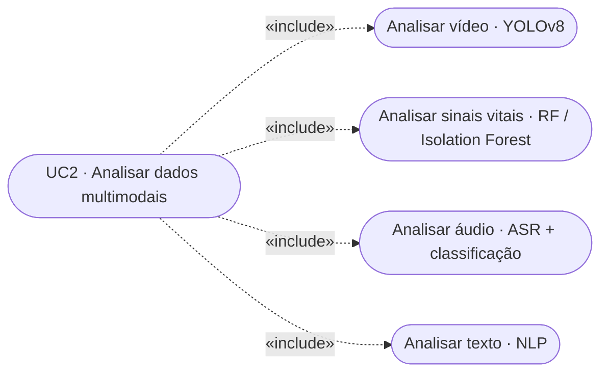
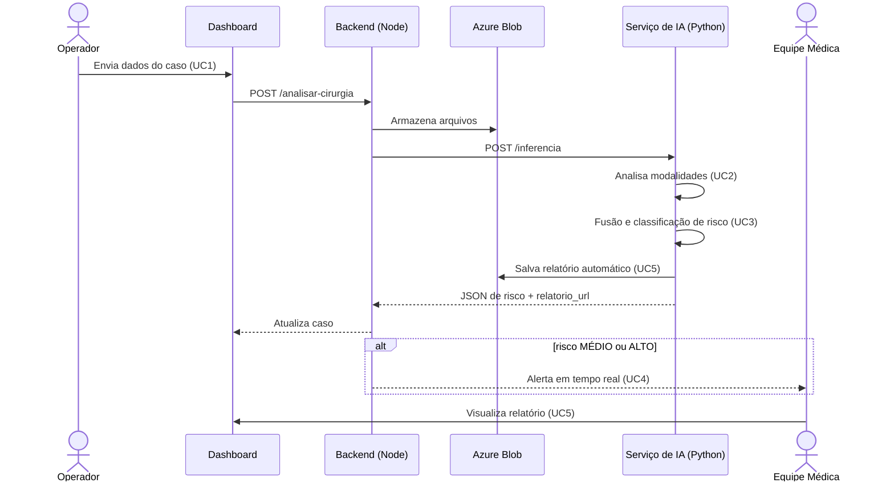

# Casos de Uso

> Escopo focado em **resolver o problema** (sem login/permissionamento). Cobre: envio do caso, análise multimodal, fusão/classificação de risco, alerta em tempo real e relatório automático.

## 1. Atores

| Ator | Tipo | Papel |
|------|------|-------|
| **Equipe Médica/Assistencial** (médico ou enfermeiro) | Primário (humano) | Recebe alertas e consulta relatórios; também pode enviar casos |
| **Operador de Monitoramento** | Primário (humano) | Envia os dados do caso para análise |
| **Paciente** | Secundário | Origem dos dados (vídeo, áudio, sinais vitais, texto) |
| **Serviço de IA** | Secundário (sistema) | Executa os modelos de análise (Python) |
| **Azure** | Secundário (sistema) | Armazenamento (Blob) e serviços cognitivos |

## 2. Diagrama geral de casos de uso

> **Nota sobre o `«extend»`:** o **UC4 (alerta)** é condicional — só é acionado quando a classificação resulta em risco **MÉDIO** ou **ALTO**.

## 3. Detalhe do UC2 (análise multimodal)

O UC2 decompõe-se em uma análise por modalidade (relação `«include»`):

## 4. Descrição curta dos casos de uso

| ID | Caso de uso | Ator(es) | Descrição |
|----|-------------|----------|-----------|
| **UC1** | Enviar caso para análise | Operador, Equipe Médica | Envia os dados do caso (vídeo, áudio, sinais vitais e/ou texto); o sistema os armazena no Azure Blob e inicia o processamento |
| **UC2** | Analisar dados multimodais | Serviço de IA | Processa cada modalidade com seu modelo (YOLOv8 para vídeo, RF/Isolation Forest para sinais vitais, ASR+classificação para áudio, NLP para texto) |
| **UC3** | Fundir evidências e classificar risco | Serviço de IA | O motor de regras combina as saídas das modalidades e classifica o risco em `BAIXO` / `MÉDIO` / `ALTO` |
| **UC4** | Emitir alerta em tempo real | Equipe Médica | Quando o risco é `MÉDIO`/`ALTO`, o sistema notifica a equipe no dashboard em tempo real (WebSocket/SSE) |
| **UC5** | Gerar e visualizar relatório automático | Equipe Médica | O sistema gera o relatório clínico do caso (PDF) e a equipe visualiza/baixa pelo painel |

## 5. Fluxo principal (do caso ao alerta)

## 6. Referências
- Contrato dos dados trocados: [contrato-api.md](contrato-api.md)
- Lógica da fusão e alerta em tempo real: [03-fase3-fusao-e-nuvem.md](03-fase3-fusao-e-nuvem.md)
- Relatório automático: [06-relatorios-automaticos.md](06-relatorios-automaticos.md)
- Telas do dashboard: [frontend.md](frontend.md)
