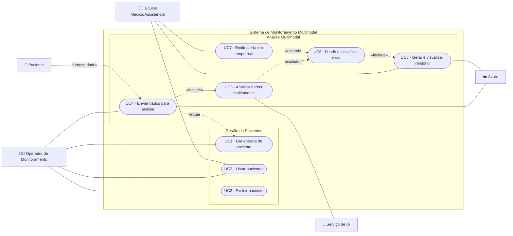
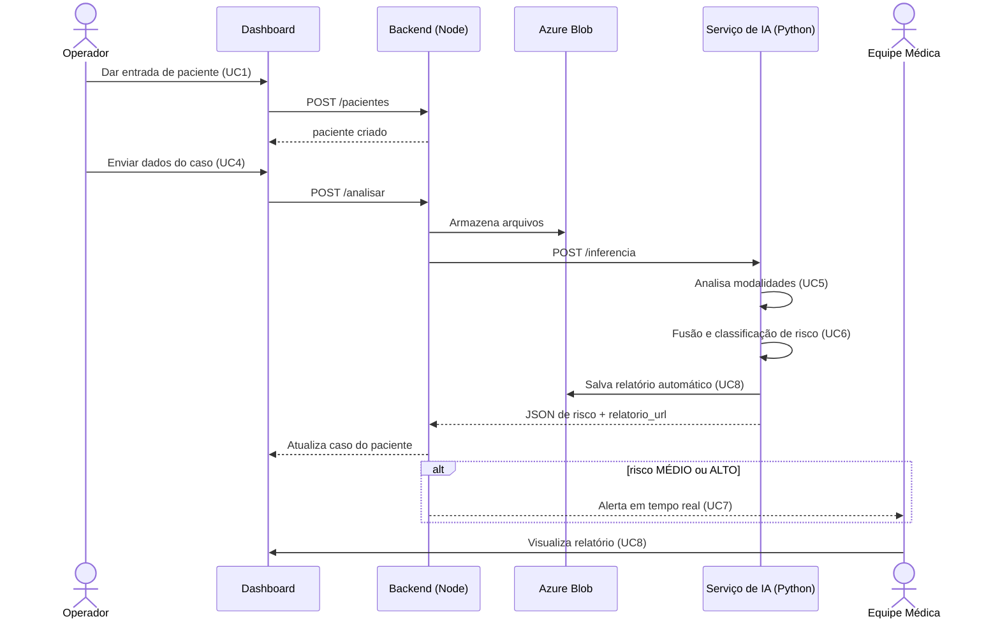

# Casos de Uso

> Escopo focado em **resolver o problema** (sem login/permissionamento). Cobre a **gestão enxuta de pacientes** (dar entrada, listar, excluir) e o fluxo de **análise multimodal** (upload, análise, fusão/risco, alerta em tempo real e relatório automático).

## 1. Atores

| Ator | Tipo | Papel |
|------|------|-------|
| **Equipe Médica/Assistencial** (médico ou enfermeiro) | Primário (humano) | Recebe alertas e consulta relatórios; também pode dar entrada e enviar dados |
| **Operador de Monitoramento** | Primário (humano) | Dá entrada do paciente e envia os dados do caso |
| **Paciente** | Secundário | Origem dos dados (vídeo, áudio, sinais vitais, texto) |
| **Serviço de IA** | Secundário (sistema) | Executa os modelos de análise (Python) |
| **Azure** | Secundário (sistema) | Armazenamento (Blob) e serviços cognitivos |

## 2. Regras de escopo da gestão de pacientes
- **Dar entrada sempre cria um paciente novo** (não há edição/atualização).
- Operações disponíveis: **dar entrada (criar)**, **listar** e **excluir**.
- Cada paciente recebe **um conjunto de dados** (vídeo/áudio/sinais/texto) para a análise.
- Dados do paciente são mínimos e pseudonimizados: **primeiro nome, idade, gestante, idade gestacional** (ver [privacidade/LGPD](07-privacidade-e-seguranca.md)).

## 3. Diagrama geral de casos de uso

> **Notas:** o **UC4** *requer* um paciente já criado (UC1). O **UC7 (alerta)** é `«extend»` — só dispara quando o risco é **MÉDIO** ou **ALTO**.

## 4. Detalhe do UC5 (análise multimodal)

## 5. Descrição curta dos casos de uso

| ID | Caso de uso | Ator(es) | Descrição |
|----|-------------|----------|-----------|
| **UC1** | Dar entrada de paciente | Operador, Equipe Médica | Cria **sempre um novo** paciente com dados mínimos (primeiro nome, idade, gestante, idade gestacional) |
| **UC2** | Listar pacientes | Operador, Equipe Médica | Exibe a lista de pacientes e o status do seu monitoramento |
| **UC3** | Excluir paciente | Operador, Equipe Médica | Remove o paciente e os dados/análise associados |
| **UC4** | Enviar dados para análise | Operador | Faz upload de vídeo, áudio, sinais vitais e/ou texto do paciente; armazena no Azure Blob e inicia o processamento (requer UC1) |
| **UC5** | Analisar dados multimodais | Serviço de IA | Processa cada modalidade com seu modelo (YOLOv8, RF/Isolation Forest, ASR+classificação, NLP) |
| **UC6** | Fundir e classificar risco | Serviço de IA | O motor de regras combina as evidências e classifica o risco em `BAIXO` / `MÉDIO` / `ALTO` |
| **UC7** | Emitir alerta em tempo real | Equipe Médica | Quando o risco é `MÉDIO`/`ALTO`, notifica a equipe no dashboard em tempo real (WebSocket/SSE) |
| **UC8** | Gerar e visualizar relatório automático | Equipe Médica | Gera o relatório clínico do caso (PDF, com cabeçalho do paciente) e a equipe visualiza/baixa |

## 6. Fluxo principal (da entrada ao alerta)

## 7. Referências
- Modelo de dados (Paciente/Caso): [arquitetura.md](arquitetura.md#7-modelo-de-dados)
- Contrato dos dados trocados: [contrato-api.md](contrato-api.md)
- Lógica da fusão e alerta em tempo real: [03-fase3-fusao-e-nuvem.md](03-fase3-fusao-e-nuvem.md)
- Relatório automático: [06-relatorios-automaticos.md](06-relatorios-automaticos.md)
- Telas do dashboard: [frontend.md](frontend.md)
