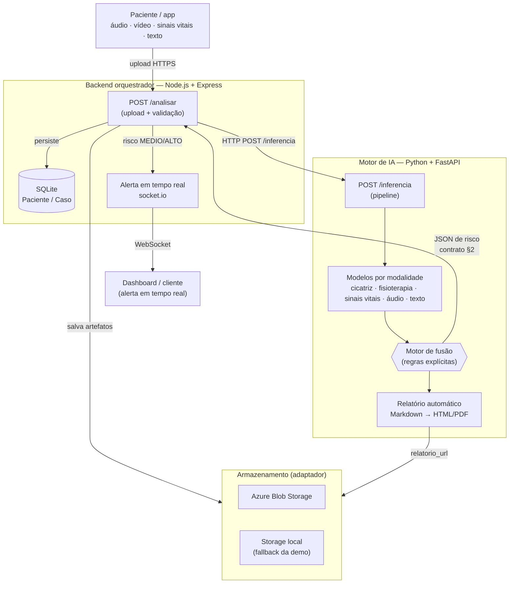

# Relatório Técnico — IA Multimodal para Saúde da Mulher (Tech Challenge Fase 4)

> **Curso:** Pós-Tech IA para Devs (8IADT) · **Entregável:** Relatório técnico (Tarefa 4.2 de
> [`docs/04-fase4-entregaveis.md`](04-fase4-entregaveis.md)).
> **Princípio deste documento:** toda métrica/afirmação técnica é **rastreável a um artefato do
> repositório** (arquivos de métrica, código, `docs/`, `.specs/`). Nenhum número foi fabricado
> (princípio "nunca inventar" do [`AGENTS.md`](../AGENTS.md)). Onde o ambiente degrada, a limitação é
> **documentada honestamente**.

> ⚠️ **Disclaimer ético.** Esta é uma solução **acadêmica de apoio à decisão clínica**. Não realiza
> diagnóstico nem substitui a avaliação de profissionais de saúde. Não deve ser usada em ambiente real
> sem validação clínica e regulatória adequada. Ver [privacidade e segurança (LGPD)](07-privacidade-e-seguranca.md).

## Sumário

1. [Fluxo multimodal e arquitetura](#1-fluxo-multimodal-e-arquitetura)
2. [Modelos por modalidade e justificativas](#2-modelos-por-modalidade-e-justificativas)
3. [Lógica de fusão e métrica do ganho](#3-lógica-de-fusão-e-métrica-do-ganho)
4. [Resultados e exemplos de anomalias](#4-resultados-e-exemplos-de-anomalias)
5. [Privacidade e segurança (LGPD)](#5-privacidade-e-segurança-lgpd)
6. [Exemplo de relatório automático](#6-exemplo-de-relatório-automático)

---

## 1. Fluxo multimodal e arquitetura

### Contexto clínico

No **pós-parto** (e gestação avançada) a mãe vai para casa e o acompanhamento enfraquece. Sinais de risco
— infecção da cicatriz da cesárea, pré-eclâmpsia, depressão pós-parto, violência doméstica — aparecem aos
poucos e ficam **espalhados** em modalidades e sistemas diferentes. A solução é o "cérebro" que **junta as
modalidades da mesma paciente** e **alerta cedo** a equipe. As **4 modalidades** monitoradas:

| Modalidade | O que a paciente envia | Risco que ajuda a detectar |
| ---------- | ---------------------- | -------------------------- |
| **Vídeo** | foto/vídeo da cicatriz da cesárea e exercícios de fisioterapia | infecção da ferida; recuperação motora |
| **Sinais vitais** | PA, frequência cardíaca, glicemia (CSV) | pré-eclâmpsia / risco hipertensivo |
| **Áudio** | relato/consulta em áudio | depressão pós-parto, ansiedade, violência |
| **Texto** | laudos/exames/evolução clínica | complicações relatadas, febre/dor |

### Arquitetura (microserviços) e fluxo de dados

A solução usa **dois serviços** (decisão de arquitetura em [`docs/arquitetura.md`](arquitetura.md)): um
**orquestrador Node.js + Express** e um **motor de IA Python + FastAPI**, integrados a **storage** (Azure
Blob ou local). O diagrama completo está em
[`docs/relatorio/diagrama-arquitetura.md`](relatorio/diagrama-arquitetura.md):



**Etapas:** (1) upload no Node; (2) artefatos no storage (Azure/local); (3) `POST /inferencia` no Python;
(4) modelos por modalidade; (5) fusão decide o risco; (6) relatório automático; (7) JSON de risco devolvido
e persistido em SQLite; (8) alerta em tempo real (socket.io) quando o risco é `MEDIO`/`ALTO`.

**Por que microserviços** ([`docs/arquitetura.md`](arquitetura.md) §2): o ecossistema de visão
computacional (YOLO, OpenCV, PyTorch) é maduro em Python; o Node concentra orquestração, banco e tempo
real; é possível escalar só o serviço de IA; e a falha de IA fica isolada no log do Python (`case_id`
rastreável em todos os logs).

**Contrato Node ↔ Python** ([`docs/contrato-api.md`](contrato-api.md)): a requisição (`POST /inferencia`)
leva `case_id`, `paciente` e as URLs das modalidades; a resposta é o **JSON de risco padronizado**
(`risco_detectado`, `evidencias`, `mensagem_alerta`, `relatorio_url`). Implementação em
[`ai-service/app/api/main.py`](../ai-service/app/api/main.py) e [`ai-service/app/pipeline.py`](../ai-service/app/pipeline.py).

---

## 2. Modelos por modalidade e justificativas

Cada modalidade expõe uma inferência com **saída padronizada** (dict do contrato §3) — decisão
[F2-DD3](../.specs/features/fase2-modelos/design.md). Código em [`ai-service/app/`](../ai-service/app/)
(um módulo por modalidade), limiares centralizados em [`app/limiares.py`](../ai-service/app/limiares.py).

| Modalidade | Modelo / técnica | Justificativa da escolha |
| ---------- | ---------------- | ------------------------ |
| **Cicatriz (vídeo)** | **YOLOv8** (`ultralytics`, `yolov8n`) — detecção de objeto; export ONNX opcional | Ecossistema de visão maduro e pronto para fine-tuning de detecção de ferida; `yolov8n` (nano) viabiliza treino rápido no mini-dataset ([F2-DD9](../.specs/features/fase2-modelos/design.md)) |
| **Fisioterapia (vídeo)** | **YOLOv8-pose** (`yolov8n-pose`) — keypoints + geometria pura em [`app/fisioterapia/angulos.py`](../ai-service/app/fisioterapia/angulos.py) | Mesmo ecossistema (`ultralytics`) cobre pose; ângulos/amplitude são regras puras, **explicáveis e testáveis** |
| **Sinais vitais** | **Random Forest** (`scikit-learn`) — principal; **Isolation Forest** opcional (anomalia) | Dados **tabulares** rotulados (`RiskLevel`) pedem modelo supervisionado robusto e explicável; Isolation Forest como complemento não supervisionado ([F2-DD6](../.specs/features/fase2-modelos/design.md)) |
| **Áudio** | **Transcrição** (Whisper local; Azure Speech opcional via env) + **classificação por palavras-chave** | Determinístico, testável **offline** e suficiente para o desafio; backend de transcrição trocável por variável de ambiente ([F2-DD7](../.specs/features/fase2-modelos/design.md)) |
| **Texto/NLP** | **Regras / palavras-chave** ([`app/texto/nlp.py`](../ai-service/app/texto/nlp.py)); sentimento Azure opcional | Explicável, sem dependência de treino, suficiente para mapear febre/dor/proteinúria → achados clínicos ([F2-DD7](../.specs/features/fase2-modelos/design.md)) |

**Por que YOLOv8/YOLOv8-pose:** maturidade do ecossistema (`ultralytics`), detecção e pose no mesmo
framework, fine-tuning simples a partir do `data.yaml` da Fase 1, e export ONNX para portabilidade.
**Por que Random Forest:** os sinais vitais são **dados tabulares** com rótulo de risco — um classificador
de árvore oferece bom desempenho com explicabilidade (importância de variáveis) e baixo custo de treino.
**Por que regras em áudio/texto:** garantem **reprodutibilidade offline** e rastreabilidade do gatilho, o
que importa num sistema de apoio à decisão clínica.

> **Degradação graciosa ([F2-DD10](../.specs/features/fase2-modelos/design.md)):** quando faltam pesos
> (YOLO) ou amostras (áudio), a modalidade retorna valor **neutro/ausente** sem quebrar o pipeline — a
> fusão decide com o que tem. Comprovado no log E2E deste ambiente (§4).

---

## 3. Lógica de fusão e métrica do ganho

### Motor de regras explícito

A fusão é um **motor de regras determinístico** (não end-to-end): a IA das modalidades produz
**evidências**; a regra de negócio **decide e explica** o alerta. Implementação em
[`ai-service/app/fusao.py`](../ai-service/app/fusao.py) (`avaliar_fusao`), decisão
[F3-DD1](../.specs/features/fase3-fusao-e-nuvem/design.md). Saída: `risco_detectado`
(`BAIXO`/`MEDIO`/`ALTO`), `mensagem_alerta` explicável e `gatilhos[]` (rastreabilidade para o relatório).

**Matriz base** (cicatriz × sinais vitais), do [contrato §4](contrato-api.md):

| Vídeo (cicatriz) | Sinais vitais | Risco |
| ---------------- | ------------- | ----- |
| sinal de infecção | de risco | **ALTO** |
| sinal de infecção | normal | **MEDIO** |
| ok / nenhum | de risco | **MEDIO** |
| ok / nenhum | normal | **BAIXO** |

**Regras de elevação** (texto/áudio como contexto), de [`app/fusao.py`](../ai-service/app/fusao.py):

- cicatriz com infecção **+** (texto de febre/dor **ou** áudio de fadiga forte) → `infeccao_puerperal` (**ALTO**);
- vitais de risco **+** texto de complicação, **ou** `pre_eclampsia` explícita → `pre_eclampsia` (**ALTO**);
- áudio de **violência** (confiança suficiente) → `violencia` (**ALTO**), aciona protocolo mesmo isolado;
- áudio de **depressão pós-parto/ansiedade** → `desconforto_psicologico` (≥ **MEDIO**);
- **contexto isolado** (só texto/áudio fraco) tem teto **MEDIO** — exceto violência;
- fisioterapia alterada é **contexto adicional**, nunca eleva o risco sozinha.

O risco final é o **maior** nível acionado e a mensagem concatena os gatilhos — alerta **explicável**.

### Métrica do ganho da fusão (vs. modalidade única)

Comparação sobre um conjunto sintético rotulado de **6 casos** (3 críticos que exigem corroboração + 3
quase-alertas/normais isolados), gerada por
[`ai-service/app/metricas_fusao.py`](../ai-service/app/metricas_fusao.py) e salva em
[`ai-service/models/metricas_fusao.json`](../ai-service/models/metricas_fusao.json) (tabela legível em
[`docs/relatorio/metricas-fusao.md`](relatorio/metricas-fusao.md)). **Modalidade única** alerta diante de
qualquer sinal isolado; **fusão** só eleva ao vermelho (`ALTO`) com corroboração.

| Cenário (n = 6) | Precisão | Recall | Taxa de FP |
| --------------- | -------- | ------ | ---------- |
| Só vídeo | 0,50 | 0,3333 | 0,3333 |
| Só sinais vitais | 1,00 | 0,6667 | 0,00 |
| Só áudio/texto | 0,6667 | 0,6667 | 0,3333 |
| **Fusão multimodal** | **1,00** | **1,00** | **0,00** |

**Conclusão:** a fusão atinge **recall 1,0** (não perde nenhum caso crítico) com **taxa de falsos positivos
0,0**, superando todas as modalidades isoladas (que perdem casos — recall ≤ 0,67 — ou geram FP até 0,33). O
ganho vem de **exigir corroboração** entre modalidades antes do alerta vermelho. Esses são números **reais**
do artefato versionado, não estimados.

---

## 4. Resultados e exemplos de anomalias

> Métricas reais já geradas nas Fases 2–3, versionadas em `ai-service/models/`. Limitações documentadas
> honestamente abaixo (DD-F4-6).

### 4.1 Sinais vitais — Random Forest

Fonte: [`ai-service/models/sinais_vitais/metrics.json`](../ai-service/models/sinais_vitais/metrics.json)
(dataset UCI *Maternal Health Risk*, **451 amostras**: 338 treino / 113 validação).

| Métrica | Valor |
| ------- | ----- |
| Acurácia (validação) | **0,646** |
| F1 macro | **0,624** |
| Classe `high` — precisão / recall / F1 | 0,84 / 0,75 / 0,79 |
| Classe `low` — F1 | 0,69 |
| Classe `mid` — F1 | 0,38 |

Matriz de confusão versionada em
[`ai-service/models/sinais_vitais/matriz_confusao.png`](../ai-service/models/sinais_vitais/matriz_confusao.png).
A classe **`high` (alto risco)** — a mais relevante clinicamente — tem o melhor desempenho (F1 0,79); a
classe **`mid`** é a mais fraca (F1 0,38), limitação esperada num dataset pequeno com fronteira ambígua
entre risco baixo e médio.

### 4.2 Cicatriz — YOLOv8n (smoke)

Fonte: [`ai-service/models/cicatriz/metrics.json`](../ai-service/models/cicatriz/metrics.json) (mini-dataset
AZH Wound, **40 épocas**, treino *smoke*).

| Métrica | Valor |
| ------- | ----- |
| mAP@50 (geral) | **0,929** |
| mAP@50 `ferida_ok` | 0,995 |
| mAP@50 `ferida_alerta` | 0,951 |
| Recall | 1,0 |
| Precisão | **0,0038** |

> **Limitação honesta (smoke):** a **precisão muito baixa (0,0038)** indica excesso de falsos positivos —
> o detector foi treinado como *smoke* num mini-dataset (poucas imagens/épocas) só para validar o pipeline
> ponta a ponta. O mAP alto reflete o conjunto reduzido. **Precisa escalar** (mais dados/épocas em GPU/Colab)
> para detecções confiáveis acima do limiar — item registrado em [`.specs/project/STATE.md`](../.specs/project/STATE.md).
> Os **pesos não são versionados** ([F2-DD4](../.specs/features/fase2-modelos/design.md)); neste ambiente
> sem os pesos a cicatriz **degrada** (evento `nenhum`) — ver §4.5.

### 4.3 Texto/NLP e baseline por modalidade

Fonte: [`ai-service/models/baseline.json`](../ai-service/models/baseline.json) (detecção binária de caso
crítico por modalidade):

| Modalidade | n | Precisão | Recall | Taxa de FP |
| ---------- | - | -------- | ------ | ---------- |
| Texto/NLP | 5 | 1,00 | 1,00 | 0,00 |
| Sinais vitais (binário crítico) | 451 | 0,594 | 0,929 | 0,209 |

O **texto/NLP** acerta 5/5 nos rótulos de referência. O baseline binário de sinais vitais prioriza
**recall (0,929)** — perde poucos casos críticos — ao custo de mais falsos positivos isolados, exatamente o
comportamento que a **fusão corrige** (§3).

### 4.4 Modalidades dependentes de dados manuais

**Áudio** e **fisioterapia (pose)** dependem de amostras de **obtenção manual** (sem download público
simples — ver [`.specs/project/STATE.md`](../.specs/project/STATE.md)). Os módulos existem e foram testados
em funções puras (classificação/geometria), mas a inferência completa **degrada** sem dados/pesos
([F2-DD10](../.specs/features/fase2-modelos/design.md)) — sem números fabricados aqui.

### 4.5 Exemplo de anomalia detectada (E2E) — caso de alto risco

Execução real de [`scripts/e2e_demo.py`](../scripts/e2e_demo.py) sobre
[`data/casos/caso_alto.json`](../data/casos/caso_alto.json), log capturado em
[`docs/relatorio/e2e-log.txt`](relatorio/e2e-log.txt):

- **Neste ambiente (sem pesos YOLO/ASR):** cicatriz e áudio **degradam**; a fusão decide **`MEDIO`** com
  `sinais_vitais_risco` (PA 150/95) + `texto_infeccao` ("febre e dor na cicatriz") e **emite o alerta em
  tempo real** (`MEDIO` aciona o socket.io).
- **Cenário de referência (com pesos treinados):** o mesmo caso corroborado escala para **`ALTO`** com o
  gatilho `infeccao_puerperal` (suspeita de **infecção puerperal**) — ver o bloco "Cenário de referência
  ALTO" no log e o relatório da §6.

Trecho do log (com `case_id` rastreável):

```text
{"logger":"pipeline:caso-alto","case_id":"caso-alto","msg":"Fusão concluída: risco=MEDIO gatilhos=sinais_vitais_risco,texto_infeccao"}
{"logger":"e2e_demo","msg":"Alerta emitido (MEDIO) para o caso caso-alto"}
=== Cenário de referência ALTO (cicatriz com pesos treinados) ===
  risco: ALTO | gatilhos: infeccao_puerperal, sinais_vitais_risco
```

---

## 5. Privacidade e segurança (LGPD)

Dados de saúde são **dados sensíveis** pela LGPD (Lei 13.709/2018). Detalhes em
[`docs/07-privacidade-e-seguranca.md`](07-privacidade-e-seguranca.md).

### Princípios adotados

- **Minimização** — coletar/usar apenas o necessário; o objeto `paciente` é o **contexto mínimo**
  (primeiro nome, idade, gestante) — ver [contrato §1](contrato-api.md).
- **Pseudonimização** — identificador opaco `case_id`; sem nome completo/CPF/prontuário no processamento.
- **Finalidade** — dados usados só para o monitoramento clínico.
- **Apoio à decisão, não diagnóstico** — a decisão é sempre humana (disclaimer ético).

### Controles técnicos ([`docs/07`](07-privacidade-e-seguranca.md) §2)

| Camada | Controle |
| ------ | -------- |
| Em trânsito | HTTPS/TLS (Node ↔ Python ↔ Azure) |
| Em repouso | Criptografia server-side do Azure Blob |
| Segredos | **Azure Key Vault** ou `.env` — **nunca no Git** (`.gitignore` cobre `.env` e credenciais) |
| Acesso | RBAC no Azure; SAS tokens com expiração |
| Auditoria | log com `case_id` de quem acessou qual caso |
| Retenção | política de expiração/limpeza após o uso |

### Dados sintéticos como estratégia de privacidade

O repositório usa **apenas dados sintéticos/abertos** (caso de exemplo com paciente fictícia, sinais vitais
e textos gerados) — isso **viabiliza a demonstração da fusão e elimina o risco de expor paciente real**. O
[`.gitignore`](../.gitignore) ignora `data/` (só metadados leves versionados) e os **pesos de modelo** (não
dados clínicos), versionando apenas **métricas**.

> ⚠️ **Disclaimer ético:** solução acadêmica de **apoio à decisão clínica**; não realiza diagnóstico nem
> substitui avaliação médica; não deve ser usada em ambiente real sem validação clínica e regulatória.

### Integração com a nuvem (Azure) e fallback

O storage usa um **adaptador Azure Blob | local** ([F3-DD8](../.specs/features/fase3-fusao-e-nuvem/design.md)):
em produção, artefatos vão para o Azure Blob com TLS, criptografia e SAS; na demo, `STORAGE_BACKEND=local`
roda **sem credencial** (fallback que garante a reprodutibilidade). O deploy real está documentado em
[`docs/deploy-azure.md`](deploy-azure.md) — pode usar o fallback local sem bloquear a avaliação.

---

## 6. Exemplo de relatório automático

Cada caso analisado gera um **relatório clínico estruturado** (requisito do PDF; template em
[`docs/06-relatorios-automaticos.md`](06-relatorios-automaticos.md)), derivado do JSON de fusão por
[`ai-service/app/relatorio.py`](../ai-service/app/relatorio.py) (Markdown → HTML → PDF com **fallback**,
[F3-DD7](../.specs/features/fase3-fusao-e-nuvem/design.md)).

O exemplo abaixo foi **gerado por código** (não escrito à mão) por
[`scripts/gerar_evidencias.py`](../scripts/gerar_evidencias.py) sobre o
[`caso_alto`](../data/casos/caso_alto.json), no **cenário de referência ALTO** (cicatriz com pesos
treinados). Artefato completo em
[`docs/relatorio/exemplo-relatorio-automatico.md`](relatorio/exemplo-relatorio-automatico.md)
(+ [`.html`](relatorio/exemplo-relatorio-automatico.html)):

```text
RELATÓRIO DE MONITORAMENTO MULTIMODAL — Caso caso-alto
Paciente: Maria, 31 anos
Data/hora: 2026-06-10T21:15:00Z
Nível de risco: ALTO

1. Resumo executivo
   Sinal de infecção na cicatriz associado a febre/dor ou sinais vitais de risco — suspeita de
   infecção puerperal. Sinais vitais alterados (PA/condição de risco) — monitorar a paciente.

2. Evidências por modalidade
   - Vídeo (cicatriz): sinal_infeccao (confiança 0.88)
   - Sinais vitais: hipertensao (valor 150/95)
   - Texto/laudo: sinal_infeccao — "Queixa de febre (38,5°C) e dor na cicatriz"

3. Classificação e gatilhos acionados
   - Infecção puerperal (cicatriz + febre/dor ou vitais de risco)
   - Sinais vitais alterados

4. Recomendação / encaminhamento
   Acionar a equipe imediatamente e priorizar avaliação médica.

AVISO: Documento de apoio à decisão clínica gerado automaticamente.
Não substitui a avaliação de profissionais de saúde.
```

---

## Rastreabilidade (artefatos citados)

| Afirmação / métrica | Artefato de origem |
| ------------------- | ------------------ |
| Arquitetura e fluxo | [`docs/arquitetura.md`](arquitetura.md), [`docs/relatorio/diagrama-arquitetura.md`](relatorio/diagrama-arquitetura.md) |
| Contrato Node ↔ Python | [`docs/contrato-api.md`](contrato-api.md) |
| Lógica de fusão | [`ai-service/app/fusao.py`](../ai-service/app/fusao.py) |
| Ganho da fusão | [`ai-service/models/metricas_fusao.json`](../ai-service/models/metricas_fusao.json) |
| Sinais vitais (RF) | [`ai-service/models/sinais_vitais/metrics.json`](../ai-service/models/sinais_vitais/metrics.json) + `matriz_confusao.png` |
| Cicatriz (YOLOv8) | [`ai-service/models/cicatriz/metrics.json`](../ai-service/models/cicatriz/metrics.json) |
| Baseline por modalidade | [`ai-service/models/baseline.json`](../ai-service/models/baseline.json) |
| Log E2E | [`docs/relatorio/e2e-log.txt`](relatorio/e2e-log.txt) |
| Relatório automático | [`ai-service/app/relatorio.py`](../ai-service/app/relatorio.py), [`docs/relatorio/exemplo-relatorio-automatico.md`](relatorio/exemplo-relatorio-automatico.md) |
| Privacidade/LGPD | [`docs/07-privacidade-e-seguranca.md`](07-privacidade-e-seguranca.md) |
| Decisões de design | [`.specs/features/`](../.specs/features/), [`.specs/project/STATE.md`](../.specs/project/STATE.md) |
