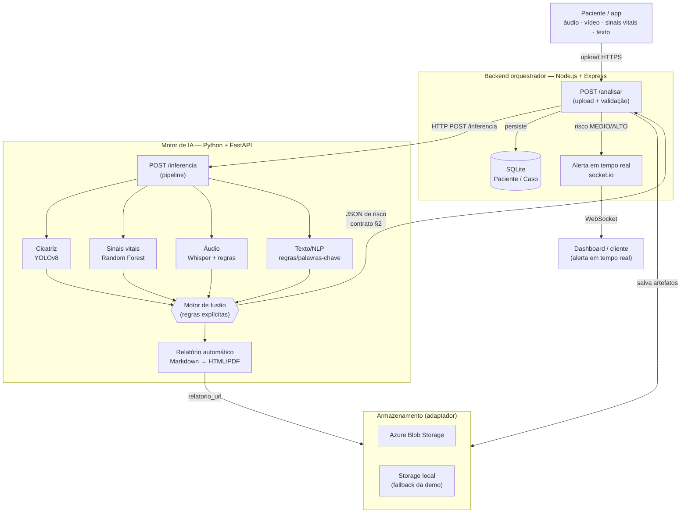

# Diagrama de arquitetura e fluxo multimodal

> Fonte de verdade: [`docs/arquitetura.md`](../arquitetura.md) §1 e [`docs/casos-de-uso.md`](../casos-de-uso.md).
> Diagrama em **Mermaid inline** (a skill `mermaid-studio` não está instalada neste ambiente; com ela, o
> bloco abaixo pode ser renderizado em SVG/PNG e temizado — DD-F4-3).

## Fluxo ponta a ponta (upload → storage → IA → fusão → alerta/relatório)

## Leitura do diagrama

1. **Upload** — a paciente envia as modalidades para o **Node (Express)** via HTTPS (`POST /analisar`).
2. **Armazenamento** — o Node grava os artefatos no **Azure Blob** ou no **storage local** (fallback da
   demo), por trás do mesmo adaptador (escolha por variável de ambiente).
3. **Inferência** — o Node chama o **serviço Python (FastAPI)** em `POST /inferencia`; o pipeline roda os
   modelos por modalidade (cicatriz, sinais vitais, áudio, texto).
4. **Fusão** — o **motor de fusão** cruza as evidências e decide **um** nível de risco explicável
   (`BAIXO`/`MEDIO`/`ALTO`) com os gatilhos acionados.
5. **Relatório** — para o caso é gerado um **relatório automático** (Markdown → HTML/PDF) salvo no storage.
6. **Resposta + persistência** — o Python devolve o **JSON de risco** (contrato §2); o Node persiste em
   **SQLite** (Paciente/Caso).
7. **Alerta em tempo real** — risco `MEDIO`/`ALTO` dispara um evento **socket.io** que chega ao
   **dashboard/cliente** instantaneamente.
